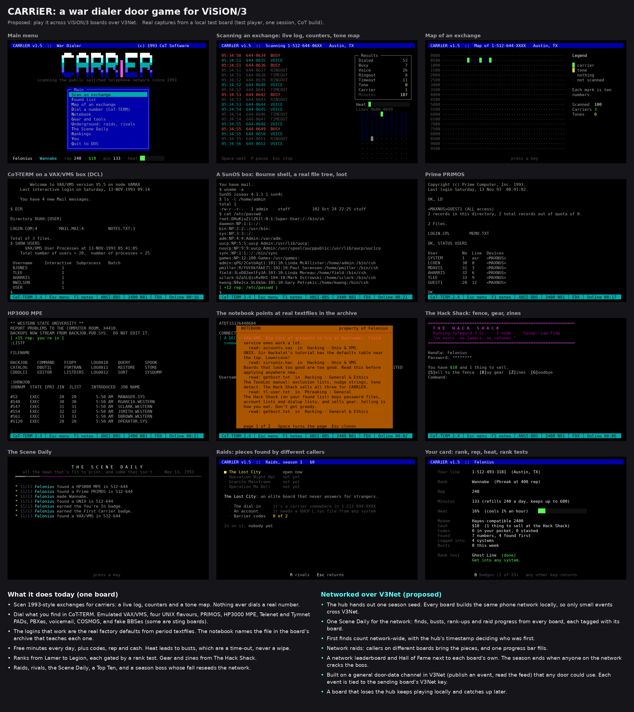

# CARRiER

A war dialer door game for [ViSiON/3](https://github.com/ViSiON-3/vision-3-bbs) BBS.

It's 1993. You're at a DOS box with a modem. Set a prefix in CARRiER, watch
the scan come back, and dial what you find in the terminal program. VAX/VMS,
a handful of UNIX flavors, PRIMOS, HP3000 MPE, Telenet and Tymnet PADs, PBXes,
voice mail, COSMOS and other people's BBSes all answer. Each one is a place
to explore, with a filesystem you can walk and a shell or command language
that works the way the real one did.

Every host is emulated. Nothing ever dials a real number or touches a real
network.



## What's in it

- **Scanning:** pick an area code, an exchange and a range of lines, then
  watch a live log, the counters and a tone map fill in. Space skips a
  number, P pauses and Esc stops.
- **The terminal:** CoT-TERM (renamable, see Settings) dials what the scan found. The logins that work
  are the real factory defaults from period textfiles.
- **The notebook:** it tells you which real textfile teaches each kind of
  system. More pages turn up as you rank up, and more come with zines bought
  from The Hack Shack.
- **Minutes, heat and busts:** you get free minutes every day. Heat leads to
  busts, and a bust is a time-out, never a wipe.
- **Ranks:** from Lamer to Legion, each one gated by a rank test.
- **The scene:** raids, rivals, the Scene Daily, a Top Ten and a Hall of Fame.
- **Seasons:** each season has a boss, the phone company's Switching Control
  Center. When someone cracks it, the season ends and the whole phone network
  is generated anew.

The full design is in [docs/design.md](docs/design.md).

## Requirements

- ViSiON/3 v0.9.7 or newer. CARRiER is a VPL script door (`v3_script`), and it
  uses only the standard scripting API, so it needs no patched build. It was
  tested on a stock install of ViSiON/3's `main` on 2026-11-13.
- A terminal that does ANSI at 80x24 or larger, such as SyncTERM, NetRunner
  or any modern terminal over SSH or telnet.

## Install

All of this is done in your ViSiON/3 install directory, the one with
`vision3`, `configs/` and `scripts/` in it.

**1. Copy in the script.** Download [`dist/carrier.js`](dist/carrier.js) and
put it in a folder of its own under `scripts/`:

```bash
mkdir -p scripts/carrier
cp carrier.js scripts/carrier/
```

**2. Add the door.** Add this entry to `configs/doors.json`. You can also use
`./config`, under **Door Programs → Doors**.

```json
{
    "code": "CARRIER",
    "name": "CARRiER",
    "category": "GAMES",
    "description": "War dialer: scan exchanges, dial what answers",
    "type": "v3_script",
    "script": "carrier.js",
    "working_directory": "scripts/carrier",
    "max_run_minutes": -1
}
```

`max_run_minutes: -1` lets a game run as long as the caller's time allows,
since scans take a while. If new callers shouldn't play before they're
validated, add `"min_access_level"` set to your board's validated level.

**3. Give it a key.** Pick one of these:

- **On the doors menu:** run `./menuedit`, open `DOORSM`, press **F5** and
  add a command with **Keys** `C`, **Command** `DOOR:CARRIER` and **ACS** `*`.
  The editor saves it to the `menus.d/v3/` overlay, so upgrades keep it. The
  stock doors menu art doesn't list the new key, so add it to the art (or to
  your news) so callers find it.
- **Or use the generated door menu:** bind `RUN:DOORMENU` to a key, and every
  door in `doors.json`, CARRiER included, is listed automatically. See
  ViSiON/3's *Generated door menus* doc.

That's it. ViSiON/3 reloads `doors.json` and the menus on its own, so you
don't need a restart.

## Settings

Settings go in the door's `args` in `doors.json`, as `name=value` words:

```json
"args": ["library=CARRiER Library", "brand=Zero"]
```

| Setting | Default | What it does |
|---|---|---|
| `library` | *(unset)* | The file area the notebook sends players to for its textfiles. Unset, each page names the file and says to look in any textfile archive. See [docs/library.md](docs/library.md) for the list of files. |
| `brand` | `CoT` | The made-up 1993 software company: the title says "(c) 1993 *brand* Software", and the terminal program is "*brand*-TERM". Up to 12 letters, digits and spaces. |

## The textfile library (optional, recommended)

The notebook is half the game. Its pages point at real period textfiles: Sir
Hackalot's UNIX tutorial, The Neophyte's Guide to Hacking, the ToneLoc
manual, Phrack and more. The default logins that work in the game are the ones
in those files. If your board has a textfile collection, put the files listed
in [docs/library.md](docs/library.md) in one file area and set
`library=<that area's name>`. Players can then read up without leaving the
board.

## Player data

Everything is in `scripts/data/carrier.json`: players, finds, the season,
raids, the Scene Daily, the Hall of Fame, and what players have left on the
systems they broke into (files, backdoors, changed passwords, mail), which
goes when the season ends. Back it up with the rest of your board.

- **Reset everything:** make sure nobody is playing, then delete the file. The next
  player to start a game begins season 1 on a new network.
- **Move a board:** copy the file across.

## Updating

Replace `scripts/carrier/carrier.js` with the new `dist/carrier.js`. Players
keep their progress, since their data is in `scripts/data/carrier.json`.

## Building from source

The source is split into modules in `src/`. `dist/carrier.js` is those
modules joined into one file, so sysops only install one file. To rebuild it
after changing the source (Python 3, no packages needed):

```bash
python3 build.py
```

`python3 build.py --check` fails if `dist/carrier.js` is out of date.

## Networked play (planned)

The plan is a CARRiER played across ViSiON/3 boards over V3Net:

- one network-wide season;
- a Scene Daily with finds, busts and raids from every board;
- network raids, where callers on different boards bring the pieces;
- a network leaderboard.

Each board still builds the phone network locally from a shared seed, so only
small events cross the network. This isn't built yet.

## License

MIT. See [LICENSE](LICENSE).

The textfiles the notebook points to belong to their authors. CARRiER
doesn't include them, it only names them.
